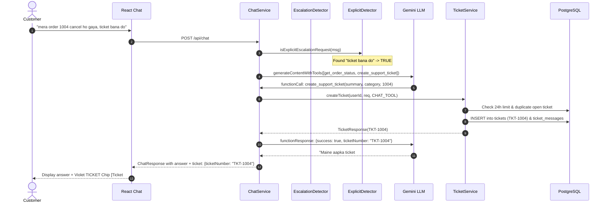

# SupportIQ Module 6: Support Tickets, Escalation & Admin Ticket Panel

Welcome to **Module 6** of SupportIQ!

In previous modules, SupportIQ learned how to ingest store policy PDFs into a vector database (pgvector), answer customer questions using RAG, and query order databases via secure LLM tool calling (function calling).

In **Module 6**, SupportIQ adds human-in-the-loop customer support: **support tickets, smart non-LLM escalation detection, and a dedicated admin ticket management console**.

---

## 📚 Table of Contents
1. [Why the Bot NEVER Creates Tickets on Soft Signals](#1-why-the-bot-never-creates-tickets-on-soft-signals)
2. [The Two Ways to Create a Support Ticket](#2-the-two-ways-to-create-a-support-ticket)
3. [Ticket Status Lifecycle & Valid Transition Rules](#3-ticket-status-lifecycle--valid-transition-rules)
4. [Security Rule 1: Customer Ownership Isolation (404 Blind Protection)](#4-security-rule-1-customer-ownership-isolation-404-blind-protection)
5. [Security Rule 2: Foreign Order Blind Dropping](#5-security-rule-2-foreign-order-blind-dropping)
6. [Rate Limiting (5 per 24 Hours) & Duplicate Protection](#6-rate-limiting-5-per-24-hours--duplicate-protection)
7. [The Non-LLM Escalation Detectors](#7-the-non-llm-escalation-detectors)
8. [End-to-End Request Flow Diagram](#8-end-to-end-request-flow-diagram)
9. [Admin Ticket Console & Plain Text Escaping](#9-admin-ticket-console--plain-text-escaping)
10. [Demo Data Initializer](#10-demo-data-initializer)

---

## 1. Why the Bot NEVER Creates Tickets on Soft Signals

When a customer expresses frustration (e.g. *"I am angry, the item was damaged"* or an order is cancelled), how should an AI assistant respond?

In poorly designed AI bots, the bot immediately creates a support ticket in the background whenever it senses anger. This is a severe anti-pattern for several reasons:

1. **Ticket Inundation & False Alarms**: Customers often vent or ask hypothetical questions (*"What happens if my package arrives damaged?"*). Automatically creating tickets floods human agents with unnecessary tickets for customers who were only seeking information.
2. **Loss of Customer Agency**: Customers prefer to review the subject, category, and description before creating an official ticket.
3. **Double Ticketing**: If the AI creates a ticket automatically while the customer is also filling out a form, duplicate tickets are created for the same issue.

### The SupportIQ Solution:
- **Soft signals NEVER create a ticket on their own.**
- Instead, the backend non-LLM `EscalationDetector` returns a soft signal flag: `escalation.suggested = true` with a computed reason code and priority.
- The chat UI displays a clean suggestion box under the answer:
  > *"Need a human to look at this? [Create support ticket]"*
- The customer remains completely in control. If they want a human agent, they click the button to open a prefilled modal and submit it.

---

## 2. The Two Ways to Create a Support Ticket

There are strictly two ways a support ticket is created in SupportIQ:

### Method A: The Interactive Chat Button & Modal (Customer Form Path)
1. The assistant answers the user's question and includes `escalation.suggested: true`.
2. The UI renders the prompt: *"Need a human to look at this?"* with a **"Create support ticket"** button.
3. Clicking the button opens a modal prefilled with:
   - **Subject**: Editable (max 120 characters).
   - **Category**: Preselected based on the escalation reason (`ORDER_ISSUE`, `REFUND`, `DAMAGED_ITEM`, `DELIVERY`, `ACCOUNT`, `OTHER`).
   - **Priority**: Preselected from the detector (`LOW`, `MEDIUM`, `HIGH`).
   - **Related Order Number**: Prefilled from conversation context if an order was discussed.
   - **Description**: Prefilled with the customer's last question (max 2000 characters).
4. Submitting the modal issues a standard `POST /api/tickets` request.
5. The chat UI immediately displays a distinct **TICKET chip** (violet) referencing the ticket number.

### Method B: Explicit Request via LLM Tool Calling (Chat Tool Path)
1. The customer explicitly asks to speak to a human or create a ticket, for example:
   - English: *"Please create a ticket for my order"*, *"I want to talk to a human agent"*, *"Register a complaint"*.
   - Hinglish (Roman script): *"mera order cancel ho gaya, ticket bana do"*, *"insaan se baat karao"*, *"support se baat karwao"*.
2. The non-LLM `ExplicitEscalationRequestDetector` recognizes this explicit phrase and **enables the `create_support_ticket` tool for that request only**.
3. If no explicit request is detected, `create_support_ticket` is **never declared to the model**.
4. The tool has **no `userId` parameter**; user identity is taken strictly from Spring Security.
5. The model calls `create_support_ticket(summary, category, relatedOrderNumber)`.
6. The backend executes the tool, creates the ticket with `source = CHAT_TOOL`, and returns the ticket number (`TKT-1004`).
7. The model informs the customer in natural Hinglish/English with the ticket number, and the chat shows the violet **TICKET chip**.

---

## 3. Ticket Status Lifecycle & Valid Transition Rules

A ticket progresses through a strict, deterministic state machine:

```
                ┌──────────────────────────────────────────────┐
                │                                              │
                ▼                                              │
   ┌─────────────────────────┐                                 │
   │          OPEN           │                                 │
   └────────────┬────────────┘                                 │
                │                                              │
        ┌───────┴───────┬──────────────────────┐               │
        │               │                      │               │
        ▼               ▼                      ▼               │
┌──────────────┐ ┌──────────────┐      ┌──────────────┐        │
│ IN_PROGRESS  │ │   RESOLVED   │      │    CLOSED    │        │
└───────┬──────┘ └──────┬───────┘      └──────────────┘        │
        │               │                      ▲               │
        └───────┬───────┘                      │               │
                │                              │               │
                ▼                              │               │
          [Any to CLOSED by ADMIN]─────────────┘               │
                │                                              │
                └──────[Customer Reply Reopens]────────────────┘
```

### Allowed Transitions:
| From Status | Allowed Next Statuses | Action / Actor |
| :--- | :--- | :--- |
| `OPEN` | `IN_PROGRESS` | Support agent starts working on the ticket |
| `OPEN` | `RESOLVED` | Quick resolution provided by support |
| `OPEN` | `CLOSED` | Admin closes ticket directly |
| `IN_PROGRESS` | `RESOLVED` | Issue has been addressed by support |
| `IN_PROGRESS` | `CLOSED` | Admin closes ticket |
| `RESOLVED` | `CLOSED` | Confirmed resolved or auto-closed |
| `RESOLVED` | `OPEN` | Reopened automatically by customer follow-up reply |
| `CLOSED` | *(None)* | **Terminal state.** No transitions allowed. |

### Enforcing State Rules:
- Any unauthorized transition (e.g. `CLOSED -> IN_PROGRESS` or `IN_PROGRESS -> OPEN`) is rejected with **HTTP 400 Bad Request**.
- Every valid status transition automatically creates a **`SYSTEM` audit message** in the ticket thread:
  > `"Status changed from OPEN to IN_PROGRESS"`

---

## 4. Security Rule 1: Customer Ownership Isolation (404 Blind Protection)

In multi-tenant customer support platforms, attackers try to probe ticket numbers (`TKT-1001`, `TKT-1002`, `TKT-1003`) to find out if other tickets exist and who owns them (IDOR / Ticket Enumeration Attack).

If the server returned:
- `404 Not Found` for a ticket that does not exist.
- `403 Forbidden` for a ticket owned by another customer.

The attacker would instantly learn that `TKT-1002` exists and belongs to a different real customer!

### How SupportIQ Solves This:
In `TicketService.java`:
```java
Ticket ticket = ticketRepository.findByTicketNumber(ticketNumber)
        .filter(t -> t.getUser().getId().equals(userId))
        .orElseThrow(() -> new ResourceNotFoundException("Ticket not found: " + ticketNumber));
```
Whether a ticket is completely nonexistent or belongs to another user, the customer receives the **exact same HTTP 404 response**:
```json
{
  "status": 404,
  "error": "Not Found",
  "message": "Ticket not found: TKT-1002"
}
```
Attackers cannot probe or discover tickets outside their own account.

---

## 5. Security Rule 2: Foreign Order Blind Dropping

When creating a ticket, a user can optionally specify a `relatedOrderNumber` (e.g. `1004`).

What if an attacker tries to link another customer's order number to their own ticket?
- If the server returned an error: *"Order 1005 belongs to another user"*, the attacker discovers that order `1005` exists.
- In SupportIQ, if `relatedOrderNumber` does not belong to the authenticated user, the backend **silently stores `null`**:
  ```java
  Optional<Order> orderOpt = orderRepository.findByOrderNumber(candidateOrderNumber);
  if (orderOpt.isPresent() && orderOpt.get().getUser().getId().equals(userId)) {
      validatedOrderNumber = candidateOrderNumber;
  }
  ```
- No error is returned, and no information is leaked about whether that order number exists or who owns it.

---

## 6. Rate Limiting (5 per 24 Hours) & Duplicate Protection

### 24-Hour Creation Limit:
To prevent spamming or denial-of-service on human agents, each user is restricted to at most **5 new tickets per 24-hour sliding window** (configurable via `app.tickets.daily-limit`).
- Exceeding this limit returns **HTTP 429 Too Many Requests**:
  > *"You have reached the maximum limit of 5 new tickets per 24 hours."*

### Duplicate Ticket Protection:
What if a customer has already raised a ticket about order `1004` (which is still `OPEN` or `IN_PROGRESS`), and then attempts to create another ticket for the same order?
- Instead of creating a duplicate ticket, SupportIQ **appends the new description as a customer reply message** to the existing open ticket.
- Returns the existing ticket with the flag:
  ```json
  {
    "ticketNumber": "TKT-1001",
    "existing": true
  }
  ```
- The frontend chat displays the friendly confirmation:
  > *"Ticket TKT-1001 is already open, we added your note."*

---

## 7. The Non-LLM Escalation Detectors

SupportIQ uses fast, deterministic, non-LLM regex matching for escalation detection, saving money and latency:

### 1. `EscalationDetector` (Soft Signal)
- Checks user query for dissatisfaction keywords:
  - **HIGH Priority**: `fraud`, `scam`, `cheated`, `damaged`, `broken`, `dhokha`, `toota`, `loot`, `fake`, `chor`.
  - **MEDIUM Priority**: `refund not received`, `refund`, `complaint`, `wrong item`, `manager`, `worst`, `angry`, `bekar`, `kharab`, `wapas nahi mila`, `defective`.
  - **Tool Results**: If an order status is `CANCELLED` or delivery is overdue, triggers MEDIUM priority.
  - **LOW Priority**: Triggered when the bot could not find an answer in store policy (`answered = false`).

### 2. `ExplicitEscalationRequestDetector` (Tool Gatekeeper)
- Checks whether the customer explicitly commanded a ticket or human:
  - English: `create a ticket`, `raise a ticket`, `open a ticket`, `talk to a human`, `human agent`, `register complaint`, `file complaint`.
  - Hinglish: `ticket banao`, `ticket bana do`, `insaan se baat`, `support se baat karao`, `agent se baat`.
- Only when this returns `true` is `create_support_ticket` included in the model's tool declarations.

---

## 8. End-to-End Request Flow Diagram



---

## 9. Admin Ticket Console & Plain Text Escaping

Admins log in using their credentials and access `/admin/tickets`:
- **Filtering**: By status (`OPEN`, `IN_PROGRESS`, `RESOLVED`, `CLOSED`), priority (`HIGH`, `MEDIUM`, `LOW`), category, or free-text search on ticket number or subject.
- **Triage Console** (`/admin/tickets/:ticketNumber`):
  - View full conversation thread with timestamps.
  - Review customer identity (**Name and Email only**; passwords, hashes, and tokens are NEVER exposed).
  - Select valid next statuses only from a restricted dropdown.
  - Send official support agent replies to the thread.
- **XSS Defense**: All ticket messages, subjects, and descriptions are rendered strictly as plain text using standard React escaping `{msg.body}`. `dangerouslySetInnerHTML` is never used.

---

## 10. Demo Data Initializer

When `app.demo-data.enabled: true` (default in local dev), `DemoDataInitializer` seeds:
- **`TKT-1001`**: `OPEN` ticket for `demo1@example.com` about cancelled order `1004` (Category: `REFUND`, Priority: `HIGH`).
- **`TKT-1002`**: `IN_PROGRESS` ticket for `demo2@example.com` about delivery delay with an admin reply from SupportIQ team.
- **`TKT-1003`**: `RESOLVED` ticket for `demo3@example.com` for a size exchange request on order `1010`.

Seeding is **100% idempotent** across repeated application restarts.
