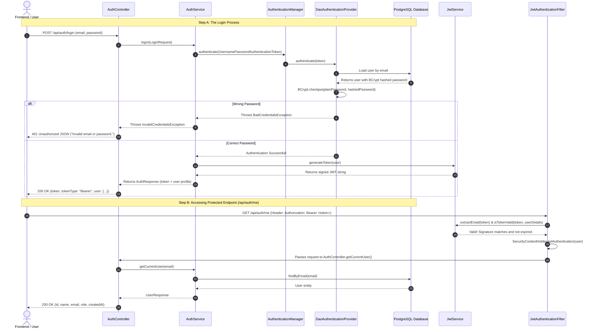

# SupportIQ - Module 1 Architecture & Login Flow Guide
*Written for beginners learning Spring Boot, Spring Security, and JWT*

---

## 🌟 Introduction

Welcome to **SupportIQ Module 1**! In this module, we built the **foundation and authentication system** for our AI customer support backend. 

Before building AI agents, chatbots, or order lookups, we need:
1. A way to store users securely in a database.
2. A way for users to create accounts and log in.
3. A way to verify a user's identity on every API request without asking them for their password every time.

This guide explains in simple English how each class works and follows the step-by-step journey of a user logging in.

---

## 📂 Project Structure Overview

Here is what our project looks like:

```
com.supportiq
 ├── config
 │    ├── CorsConfig.java           <- Controls which websites (like our frontend) can talk to this backend
 │    ├── DataInitializer.java     <- Seeds a default admin user when the app starts
 │    └── SecurityConfig.java       <- The master security rulebook for the app
 ├── controller
 │    ├── AdminController.java      <- Protected endpoints only administrators can visit
 │    └── AuthController.java       <- Public & profile endpoints (register, login, me)
 ├── dto
 │    ├── AuthResponse.java         <- What we send back on successful login (token + user data)
 │    ├── ErrorResponse.java        <- Standard format for all error responses
 │    ├── LoginRequest.java         <- Holds email & password from the login form
 │    ├── RegisterRequest.java      <- Holds name, email, password from registration form
 │    └── UserResponse.java         <- Safe user data (NEVER sends password!)
 ├── exception
 │    ├── DuplicateEmailException.java   <- Thrown when registering an email that already exists
 │    ├── GlobalExceptionHandler.java    <- Catches errors anywhere in the app and turns them into clean JSON
 │    ├── InvalidCredentialsException.java <- Thrown when login email or password is wrong
 │    └── ResourceNotFoundException.java <- Thrown when something isn't found in the database
 ├── model
 │    ├── Role.java                 <- Enum listing allowed roles (CUSTOMER, ADMIN)
 │    └── User.java                 <- Represents the 'users' table in PostgreSQL
 ├── repository
 │    └── UserRepository.java       <- Spring Data JPA helper to query users from the database
 ├── security
 │    ├── CustomAccessDeniedHandler.java  <- Returns JSON 403 when a user lacks permission
 │    ├── JwtAuthenticationEntryPoint.java <- Returns JSON 401 when an unauthenticated user hits a protected endpoint
 │    └── JwtAuthenticationFilter.java    <- Inspects every incoming HTTP request for a valid JWT
 └── service
      ├── AuthService.java          <- Business logic for registering and logging in
      ├── CustomUserDetailsService.java <- Teaches Spring Security how to load a user by email
      └── JwtService.java           <- Creates, signs, and validates cryptographic JWT tokens
```

---

## 🔍 Detailed Class Explanations

### 1. `model/User.java` and `model/Role.java`
- **`Role`**: An enumeration (`enum`) specifying the two kinds of users in SupportIQ:
  - `CUSTOMER`: Standard store shoppers asking support questions.
  - `ADMIN`: Support supervisors and system managers.
- **`User`**: A Java object that maps directly to the `users` table in PostgreSQL (via `@Entity`).
  - Fields: `id`, `name`, `email` (unique), `password` (hashed), `role`, and `createdAt`.
  - Notice `password`: It holds a **scrambled hash**, never the plain password!
  - `@PrePersist`: Automatically sets the timestamp right before saving to the database.

---

### 2. `repository/UserRepository.java`
- Spring Data JPA interface.
- You don't need to write raw SQL! Just by declaring:
  - `findByEmail(String email)`
  - `existsByEmail(String email)`
  - `existsByRole(Role role)`
- Spring automatically generates the underlying SQL queries for PostgreSQL.

---

### 3. `dto/` (Data Transfer Objects)
Why don't we just accept and return the `User` entity directly in controllers?
- **Security**: The `User` entity contains the `password` field. If we returned the entity directly, the password hash could leak to clients.
- **Separation of Concerns**: Request bodies from clients often have different validation requirements than the internal database entity.
- **Classes**:
  - `RegisterRequest`: Validates that `name` is not blank, `email` has a proper format, and `password` has at least 8 characters. Notice it has **no role field**—users can't make themselves admins!
  - `LoginRequest`: Takes `email` and `password`.
  - `UserResponse`: Returns safe details (`id`, `name`, `email`, `role`, `createdAt`). Never includes `password`.
  - `AuthResponse`: Bundles the generated JWT token with the `UserResponse`.
  - `ErrorResponse`: Ensures every error returns a clean, uniform JSON structure (`timestamp`, `status`, `error`, `message`, `path`).

---

### 4. `service/JwtService.java`
**What is a JWT?** A JSON Web Token is a digital "passport" encoded with cryptographic signatures.
- When a user logs in, `JwtService` creates a token containing:
  - Subject: The user's email.
  - Claims: `role` (e.g. `CUSTOMER` or `ADMIN`) and `userId`.
  - Expiration: By default, 24 hours from creation.
- It signs the token using the secret key from `application.yml` via HMAC-SHA256.
- Because only our server knows the secret key, no hacker can tamper with the role or user ID without breaking the signature!

---

### 5. `service/CustomUserDetailsService.java`
- Spring Security doesn't automatically know our custom `User` table structure.
- `CustomUserDetailsService` implements Spring's `UserDetailsService`.
- Its job is to take an email string, look it up in `UserRepository`, and return a Spring Security `UserDetails` object with the user's password and granted authorities (`ROLE_CUSTOMER` or `ROLE_ADMIN`).

---

### 6. `service/AuthService.java`
This is where the core business decisions happen:
- `register(RegisterRequest)`:
  1. Checks if the email is already in the database. If so, throws `DuplicateEmailException`.
  2. Scrambles the password using `passwordEncoder.encode(...)`.
  3. Hardcodes the role to `Role.CUSTOMER`.
  4. Saves to PostgreSQL and returns a safe `UserResponse`.
- `login(LoginRequest)`:
  1. Uses Spring's `AuthenticationManager` to verify the email and password.
  2. If the password is wrong, it rejects the request with `InvalidCredentialsException`.
  3. If correct, it generates a JWT using `JwtService` and returns an `AuthResponse`.
- `getCurrentUser(email)`:
  1. Finds the user in the database and returns their profile.

---

### 7. `security/JwtAuthenticationFilter.java`
- Sits in front of the application like a security checkpoint.
- Every incoming HTTP request passes through here once (`OncePerRequestFilter`).
- It looks for the header: `Authorization: Bearer <token>`.
- If found:
  1. It asks `JwtService` to verify the signature and read the email.
  2. It loads the user details and puts an authenticated token into `SecurityContextHolder`.
  3. Spring Security now knows exactly who is making this request for the remainder of the thread!

---

### 8. `security/JwtAuthenticationEntryPoint.java` and `CustomAccessDeniedHandler.java`
By default, Spring Security might send back HTML error pages or redirect to a login form.
- `JwtAuthenticationEntryPoint`: Triggers when an anonymous visitor tries to access a protected URL without a token. It returns a clean **401 Unauthorized** JSON response.
- `CustomAccessDeniedHandler`: Triggers when a logged-in user tries to visit a URL they don't have permission for (e.g., a `CUSTOMER` trying to access `/api/admin/**`). It returns a clean **403 Forbidden** JSON response.

---

### 9. `config/SecurityConfig.java`
This is the master configuration for our application's security:
- **Stateless Sessions (`STATELESS`)**: We don't store HTTP session cookies on the server. Every request must present its own JWT.
- **CSRF Disabled**: CSRF attacks trick web browsers into sending saved session cookies. Since we don't use cookies and only use JWTs in headers, disabling CSRF is safe and standard for REST APIs.
- **BCrypt Password Encoder**: Ensures passwords are one-way hashed with high computational difficulty.
- **Endpoint Rules**:
  - `/api/auth/register` & `/api/auth/login` -> Public (`permitAll()`).
  - `/api/admin/**` -> Only users with `ROLE_ADMIN`.
  - All other routes -> Must be logged in (`authenticated()`).

---

### 10. `config/DataInitializer.java`
- Runs once every time the Spring Boot application starts up (`CommandLineRunner`).
- Checks if any user with `ROLE_ADMIN` exists in the database.
- If none exists, it automatically creates the default administrator (`admin@supportiq.com` / `Admin@12345`), hashes the password, and saves it.

---

### 11. `exception/GlobalExceptionHandler.java`
- Decorated with `@RestControllerAdvice`.
- Catches any exceptions thrown by any controller or service across the app:
  - Input validation failures (e.g. short password) -> returns **400 Bad Request** with details of each field.
  - `DuplicateEmailException` -> returns **409 Conflict**.
  - `InvalidCredentialsException` / `BadCredentialsException` -> returns **401 Unauthorized**.
  - `AccessDeniedException` -> returns **403 Forbidden**.
  - Any unknown crash (`Exception`) -> logs the error securely to the console and returns a safe **500 Internal Server Error** without leaking sensitive database stack traces.

---

## 🔄 The Complete Journey: How the Login Flow Works

Here is step-by-step what happens when a user logs in and accesses their profile:



### Explanation of the Steps:

1. **Submission**: The user types `jane@example.com` and `Password123` into the client and sends `POST /api/auth/login`.
2. **Authentication Check**: `AuthService` asks Spring Security's `AuthenticationManager` to verify the credentials.
3. **Database Lookup**: Spring Security loads the existing user record from PostgreSQL.
4. **BCrypt Password Comparison**: Spring compares the plaintext password from the user with the scrambled hash in the database using the BCrypt algorithm.
5. **Token Generation**: If they match, `JwtService` issues a signed JWT token containing the user's email, user ID, and role (`CUSTOMER`).
6. **Subsequent Calls**: For any future requests (e.g. `GET /api/auth/me`), the client does not send the password again. Instead, it sends the token in the header:
   `Authorization: Bearer <token>`
7. **Filter Verification**: `JwtAuthenticationFilter` reads the token, verifies the cryptographic signature with our server's secret key, and tells Spring Security that this request is authenticated!
