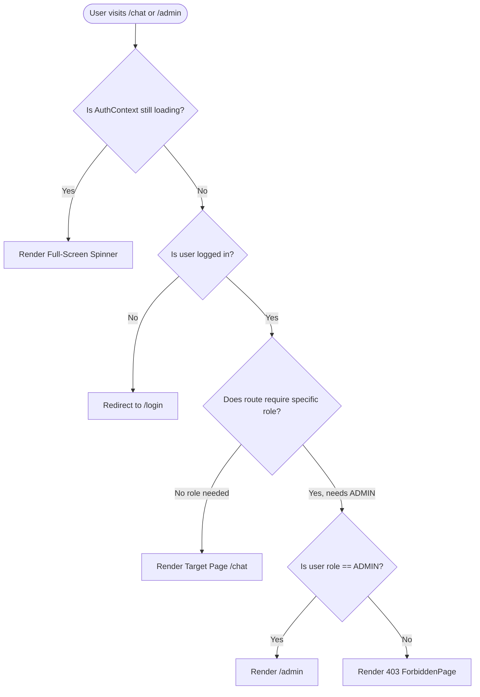
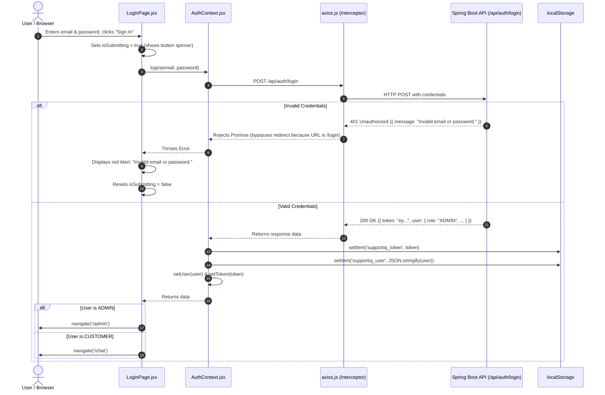

# SupportIQ — Module 2 Architecture & Authentication Guide
*A beginner-friendly guide to React Context, Protected Routes, Axios Interceptors, and the Frontend Login Lifecycle*

---

## 🌟 1. Introduction: What Did We Build in Module 2?

In **Module 1**, we built the Spring Boot backend with PostgreSQL, security filters, and JWT issuance.

In **Module 2**, we built the **React frontend base** for SupportIQ. Before we can show customers an AI chat widget or let admins view tickets, our frontend needs answers to fundamental questions:
1. *Who is currently using the app?* (Anonymous visitor, Customer, or Administrator?)
2. *Where do we store their digital passport (JWT)?*
3. *How do we attach the JWT to outgoing HTTP requests without copying and pasting headers everywhere?*
4. *How do we block regular customers from opening the Admin dashboard?*
5. *What happens when a user refreshes the page or logs out?*

This document breaks down every concept in simple, beginner-friendly language.

---

## 🧩 2. What is `AuthContext` and Why Do We Need It?

### The Problem: "Prop Drilling"
Imagine your app has a `Navbar`, a `ChatPage`, a `ProfileDropdown`, and an `AdminDashboard`. All of them need to know:
- Is the user logged in?
- What is their name?
- What is their role (`CUSTOMER` or `ADMIN`)?

Without Context, you would have to store this data in `App.jsx` and pass it down as props through dozens of intermediate components that don't even care about it. This tedious chore is called **prop drilling**.

```
App (holds user state)
 └── Layout
      └── Header
           └── Navbar (finally uses user state!)
```

### The Solution: React Context
**React Context** acts like a global bulletin board. Any component anywhere in the tree can directly read from it or write to it by using our custom hook `useAuth()`.

```
[ AuthContext (Global Bulletin Board) ]
     ▲               ▲               ▲
     │               │               │
  Navbar        ChatPage      AdminDashboard
```

### What State Does `AuthContext` Hold?
Inside [`src/context/AuthContext.jsx`](file:///c:/Users/user/Desktop/Support/supportiq-frontend/src/context/AuthContext.jsx):

| State / Function | Purpose |
| :--- | :--- |
| `user` | An object with `{ id, name, email, role, createdAt }` or `null` when logged out. |
| `token` | The raw JWT string (e.g. `eyJhbGciOi...`) or `null`. |
| `loading` | A boolean indicating whether we are still restoring the session from the backend on page load. |
| `login(email, password)` | Sends credentials to `/api/auth/login`, saves the token to `localStorage`, and updates `user`. |
| `register(name, email, password)` | Sends customer registration to `/api/auth/register`. |
| `logout()` | Purges `localStorage` and resets state to `null`. |

---

## 🛡️ 3. What is `ProtectedRoute`?

A **Protected Route** is a React wrapper component that acts like a security guard stationed at the door of private pages.

### How `ProtectedRoute` Makes Decisions:



### Key Safety Rule: The Loading State Check
When a user presses **F5** to refresh `/chat`, React briefly boots up with an empty state before it has time to read `localStorage` and verify the token with the backend.
If `ProtectedRoute` didn't check `if (loading) return <Spinner />`, it would mistakenly believe the user is logged out and kick them to `/login`! The `loading` flag prevents this jarring "false logout".

---

## 🚀 4. What are Axios Interceptors?

Think of Axios like a postal carrier that transports letters (HTTP requests) back and forth between React and the Spring Boot backend.
An **interceptor** is a checkpoint where you can inspect or modify every letter before it leaves the building or as soon as it arrives.

We created our configured instance in [`src/api/axios.js`](file:///c:/Users/user/Desktop/Support/supportiq-frontend/src/api/axios.js).

### A. The Request Interceptor (Outgoing Checkpoint)
**Why we need it:**
Instead of manually typing `headers: { Authorization: 'Bearer ...' }` on every single API call across 50 components, the request interceptor does this automatically:

```javascript
api.interceptors.request.use((config) => {
  const token = getStoredToken();
  if (token) {
    config.headers.Authorization = `Bearer ${token}`;
  }
  return config;
});
```

Whenever any part of our app calls `api.get('/api/auth/me')` or `api.get('/api/admin/ping')`, the JWT is invisibly stamped onto the envelope.

---

### B. The Response Interceptor (Incoming Checkpoint)
**Why we need it:**
What happens if a user leaves their computer for 24 hours, their JWT expires, and then they click a button?
The backend returns **401 Unauthorized**.
Instead of writing error-handling logic in every component to check for 401s, our response interceptor catches it globally:

```javascript
api.interceptors.response.use(
  (response) => response,
  (error) => {
    if (error.response?.status === 401) {
      const requestUrl = error.config?.url || '';
      
      // CRITICAL EXCLUSION:
      // Do NOT redirect if the 401 came from login or register!
      const isAuthEndpoint =
        requestUrl.includes('/api/auth/login') ||
        requestUrl.includes('/api/auth/register');

      if (!isAuthEndpoint) {
        clearStoredAuth();
        window.location.href = '/login';
      }
    }
    return Promise.reject(error);
  }
);
```

### 💡 Why Must We Exclude `/login` from the 401 Redirect?
This is a classic rookie pitfall:
1. When a user types a wrong password on `/login`, the backend responds with **401 Unauthorized** and a JSON body: `{ "message": "Invalid email or password." }`.
2. If our interceptor reacted to *all* 401s by redirecting to `/login`, it would refresh the page and wipe out the React state before the user could ever see the error alert!
3. By excluding `/api/auth/login`, the login form receives the 401 error normally, catches it in its `try / catch` block, and displays: `"Invalid email or password."` in a clean red alert banner.

---

## 🔄 5. The Complete End-to-End Login Flow

Here is the exact journey of what happens behind the scenes from the moment a user clicks "Sign In":



---

## 🔄 6. What Happens When the User Refreshes the Page (`F5`)?

React components live in memory; when you hit refresh, that memory is cleared. Here is how SupportIQ restores the session seamlessly:

1. **App Mounts**: `AuthProvider` runs its `useEffect` hook. `loading` is set to `true`.
2. **Storage Check**: It checks `localStorage.getItem('supportiq_token')`.
   - If no token exists, `loading` is set to `false`, and the visitor is treated as an anonymous guest.
3. **Backend Verification (`GET /api/auth/me`)**:
   - If a token is found, we do not simply trust whatever was stored on disk (the user's role might have changed or the token might have expired).
   - Our Axios request interceptor attaches the token: `Authorization: Bearer <token>`.
   - The backend validates the signature and returns the freshest user profile.
4. **State Restoration**: `setUser(userData)` updates React state and `loading` is set to `false`.
5. **Route Unlocks**: `ProtectedRoute` sees `loading === false` and `user != null`, rendering the requested page without ever redirecting to login.

---

## 🔒 7. Security Deep Dive: `localStorage` vs. `httpOnly` Cookies

In this project, we store the JWT in browser `localStorage`:

```javascript
localStorage.setItem('supportiq_token', token);
```

### Why did we use `localStorage` here?
- **Ease of Learning**: It allows developers to inspect tokens in Chrome DevTools (`Application -> Local Storage`) and test APIs without complex domain/cookie configuration.
- **Portability**: It works immediately across different ports (`localhost:5173` to `localhost:8080`) without CORS cookie constraints.

### The Production Security Trade-off: Cross-Site Scripting (XSS)
- Any JavaScript running on the page can access `localStorage.getItem()`.
- If an attacker manages to inject a malicious script into the website (XSS), they can steal the JWT token and impersonate the user.

### The Production Alternative: `httpOnly` Cookies
- In enterprise production systems, authentication tokens are stored in **HTTP Cookies** with the flags:
  - `httpOnly`: Prevents client-side JavaScript from reading the cookie entirely.
  - `Secure`: Ensures the cookie is only transmitted over HTTPS encrypted connections.
  - `SameSite=Strict` or `Lax`: Protects against Cross-Site Request Forgery (CSRF).
- Because JavaScript cannot read an `httpOnly` cookie, even if an attacker finds an XSS vulnerability, they cannot exfiltrate the user's authentication token.

---

## 🎓 Summary of Key Takeaways

1. **`AuthContext`** gives every component immediate access to `user`, `token`, `login()`, and `logout()` without prop drilling.
2. **`ProtectedRoute`** guards sensitive routes and enforces Role-Based Access Control (RBAC) so customers cannot view admin features.
3. **Axios Request Interceptors** automatically attach `Authorization: Bearer <token>` to every outgoing request.
4. **Axios Response Interceptors** catch expired tokens (401) globally and redirect to `/login`, while exempting the login/register forms so validation errors can be shown.
5. **The `loading` state** is essential to prevent false logouts during page reloads while `GET /api/auth/me` validates the active session.
